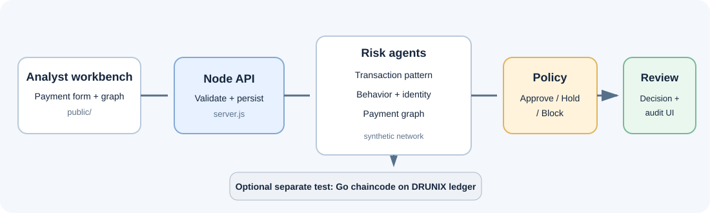
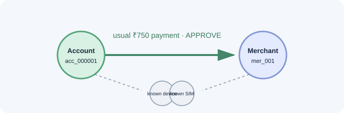
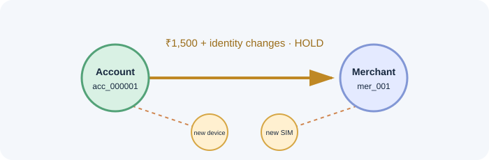
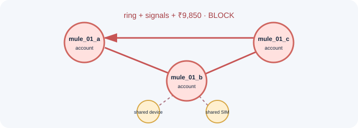

# TrustMesh

TrustMesh is a working local prototype for pre-settlement UPI fraud screening. It combines a synthetic four-bank payment network, three risk agents, an orchestration policy, an interactive entity knowledge graph, analyst review, a fraud registry, and a hash-linked local audit/block journal.

This README includes the architecture, graph explanation, click-by-click instructions, and three illustrated scenarios. See [ARCHITECTURE.md](ARCHITECTURE.md) for deeper component and API details.

## Run

Requires Node.js 20 or newer. The prototype uses only Node's built-in modules.

```powershell
npm start
```

Open [http://127.0.0.1:4173](http://127.0.0.1:4173). By default the server generates 300,000 synthetic transactions at startup. Set `TRUSTMESH_TRANSACTIONS` to a value from 1,000 through 500,000 to change the size, and `PORT` to change the local port.

## Workbench

- Screen a payment from a synthetic account to another account or merchant.
- Add new-device, SIM-change, impossible-travel, and scripted-interaction signals.
- Explore the knowledge graph: directed payment edges, shared-device/SIM identity links, account/merchant/device/SIM nodes, and entity inspection.
- Review held payments. Analyst approval commits them; rejection adds the payee to the fraud registry.
- Inspect recent decisions, review queue, registry, and the tamper-evident audit trail.

## Architecture and request flow



1. **Analyst UI** — The browser serves the payment form, decisions and interactive knowledge graph from `public/`.
2. **Node API** — `server.js` validates the request, looks up the synthetic account profile and coordinates the response. The form submits to `POST /api/transactions/analyze`.
3. **Three risk agents** — Transaction-pattern scoring checks amount, velocity and time; behavioral scoring checks device, SIM, travel and scripted interaction; graph-network scoring examines payment cycles, fan-in, pass-through behavior and shared identities.
4. **Orchestrator policy** — A maximum agent score above `0.85` blocks the payment. Otherwise a blended risk above `0.60` is held. Lower risk is approved. The response includes the decision and supporting signals.
5. **Workbench and local records** — The UI shows the decision, refreshes the graph around the sender, and updates recent decisions, reviews, registry, block ledger and audit trail. Local app records persist under ignored `data/` files.
6. **Optional ledger workflow** — Go chaincode can be deployed to the isolated DRUNIX test network by the workflow described below. That workflow submits and verifies ledger entries; ordinary local UI requests do not automatically write to a live peer.

The local synthetic graph and screening engine require only Node.js. Docker/Go are for the optional DRUNIX ledger workflow. This is a prototype, not a live UPI connection or a payment processor.

## Knowledge graph: what it shows and how to open it

The graph is already on the main page; there is no separate build button. It is a relationship map, not a conventional chart: circles are accounts, merchants, devices or SIM identities; directed arrows are payments; dashed identity links represent a shared device/SIM association. Select a node to inspect it and its activity. Risk coloring helps draw attention to higher-risk neighborhoods. The exact graph shown is an interactive subset around the selected entity, not the entire 300,000-edge network at once.



1. Run `npm start`, open `http://127.0.0.1:4173`, and wait for **API connected** and the network counters.
2. In **Find account, VPA, merchant…**, search for `acc_000001` or `mule_01_a`; choose its suggestion to focus the map.
3. Choose **1 hop**, **2 hops** or **3 hops** to control how far relationships extend. Two hops is a useful starting view.
4. Click a graph node to inspect its entity details. Use **Network overview** to return to the overview. After you screen a transfer, the graph automatically refreshes around the sender.

If the graph is blank, confirm **API connected**, refresh the page, and search one of the seeded IDs above. The graph data comes from `GET /api/graph`; search suggestions come from `GET /api/search`.

## Three runnable scenarios

These scenarios use seeded synthetic identities. In the **Screen a payment** panel fill **FROM**, **TO**, and **AMOUNT**, set the stated checkboxes, then click **Screen transaction**. Expected results are the seeded examples verified against the local screening pipeline. The diagrams explain the relationship pattern; they are illustrative views, while the live graph can differ with hop depth and focus.

### Scenario 1 — Familiar merchant payment (APPROVE)


**Enter:** FROM `acc_000001`; TO `mer_001`; AMOUNT `750`; leave every signal unchecked.

**Expected:** `APPROVE`. The transaction is low risk for this seeded profile. It appears under **Recent decisions**. Search `acc_000001` in the graph to see its neighborhood and click the merchant or account node to inspect it.

**What the picture means:** the solid arrow indicates the account-to-merchant payment direction. The two small nodes are known device/SIM identities linked to the relationship context. Green indicates the low-risk example.

### Scenario 2 — Account takeover indicators (HOLD)



**Enter:** FROM `acc_000001`; TO `mer_001`; AMOUNT `1500`; check **New or unrecognised device** and **SIM changed recently**; leave impossible travel and scripted interaction unchecked.

**Expected:** `HOLD`. The identity changes raise the risk enough for analyst review. Click **Review queue**, then approve or reject the held row. Approval records the analyst outcome; rejection adds the payee to the local **Fraud registry**. Review and registry activity can be inspected in **Audit trail**.

**What the picture means:** the payment path is amber, and the device and SIM nodes are marked as new. It represents identity-risk context attached to an otherwise familiar account-to-merchant payment.

### Scenario 3 — Mule-ring transfer (BLOCK)



**Enter:** FROM `mule_01_a`; TO `mule_01_b`; AMOUNT `9850`; check all four signals: **New or unrecognised device**, **SIM changed recently**, **Impossible travel detected**, and **Scripted interaction pattern**.

**Expected:** `BLOCK`. The direct behavioral signals combine with the seeded mule-ring context. Find `mule_01_a` in the graph and use **2 hops** or **3 hops** to inspect the ring. The blocked transaction appears under **Recent decisions** and **Block ledger**.

**What the picture means:** red account nodes and directed edges show a circular flow across the mule accounts. Dashed links connect shared device/SIM evidence. These relationship patterns are graph-agent evidence; the four checked signals add behavioral evidence.

### Same scenarios through the API

The examples can also be submitted to `POST /api/transactions/analyze`:

```json
{"from":"acc_000001","to":"mer_001","amount":750}
```

```json
{"from":"acc_000001","to":"mer_001","amount":1500,"newDevice":true,"newSim":true}
```

```json
{"from":"mule_01_a","to":"mule_01_b","amount":9850,"newDevice":true,"newSim":true,"impossibleTravel":true,"scriptedInput":true}
```

Other workbench tabs: **Recent decisions** shows outcomes and score explanations; **Review queue** contains held items; **Fraud registry** lists registered payees; **Block ledger** lists blocked decisions; **Audit trail** records screening and analyst activity. Use ↻ to refresh.

## Backend

- `server.js` — HTTP API, synthetic network initialization, transaction screening, decision persistence, review operations, and static UI host.
- `server/data-store.cjs` — deterministic seeded 300k-transaction network and indexed graph/search data.
- `server/agents/transaction-pattern.cjs` — amount, velocity, and time-of-day scoring.
- `server/agents/behavioral-biometric.cjs` — device, SIM, location-velocity, and device-sharing scoring.
- `server/agents/graph-network.cjs` — cross-bank cycle/fan-in analysis and two-hop message passing.
- `server/agents/orchestrator.cjs` — deterministic 0.85 veto and 0.60 hold policy.
- `server/storage/` — KeyDB-like profile cache and Yugabyte-style graph development adapters.
- `api/agent.proto` — gRPC inference boundary contract.
- `chaincode/trustmesh/` — Go chaincode contracts for transaction gate, fraud registry, and audit trail.

## API

- `GET /api/health`, `/api/overview`, `/api/graph`, `/api/search?q=...`
- `GET /api/entities/:id`, `/api/transactions`, `/api/reviews`, `/api/registry`, `/api/audit`, `/api/blocks`
- `POST /api/transactions/analyze` — run the three agents and orchestrator, then record approve/block/hold outcome.
- `POST /api/reviews/:id` — approve a held item and commit it.
- `POST /api/reviews/reject` — reject a held item and register its payee.

Decision records, registry changes, and approved local block records append to ignored files under `data/`.

## Integration boundary

This is a local prototype. The network, payments, and account identities are synthetic. The DRUNIX sandbox status labels the intended integration environment; this app does not claim to connect to live bank rails, a live DRUNIX peer network, KeyDB, YugabyteDB, gRPC, ONNX, or Kubernetes. The adapters and Go contracts are integration starting points; deployment credentials and network configuration are still required for live use.

### Run the on-chain DRUNIX smoke workflow

The [Yaashu2003/drunix fork](https://github.com/Yaashu2003/drunix) includes a manual GitHub Actions workflow: [TrustMesh on DRUNIX test network](https://github.com/Yaashu2003/drunix/actions/workflows/trustmesh-testnet-smoke.yml). Open the **Actions** tab, select that workflow, and choose **Run workflow**. It uses a standard public Ubuntu runner, builds the DRUNIX tools, starts the two-organization test network, deploys this repository's TrustMesh chaincode, screens three synthetic payments through the Node API, submits the actual decisions to the test peer, and queries the payment and audit records back from ledger state.

The runner is temporary and tears down the network after the run. These are real ledger writes in an isolated DRUNIX test network, not real UPI transfers. Standard GitHub-hosted runners are free for public repositories; the workflow doesn't use Docker Desktop subscriptions or paid services. See [GitHub Actions billing](https://docs.github.com/en/actions/concepts/billing-and-usage).

The workflow passed on 2026-11-19: familiar purchase `APPROVE`, new-device/SIM `HOLD`, and mule-ring `BLOCK` were each confirmed from both payment state and `AuditTrail`. See the [successful run](https://github.com/Yaashu2003/drunix/actions/runs/44453878225) and the [architecture guide](ARCHITECTURE.md) for transaction IDs.
