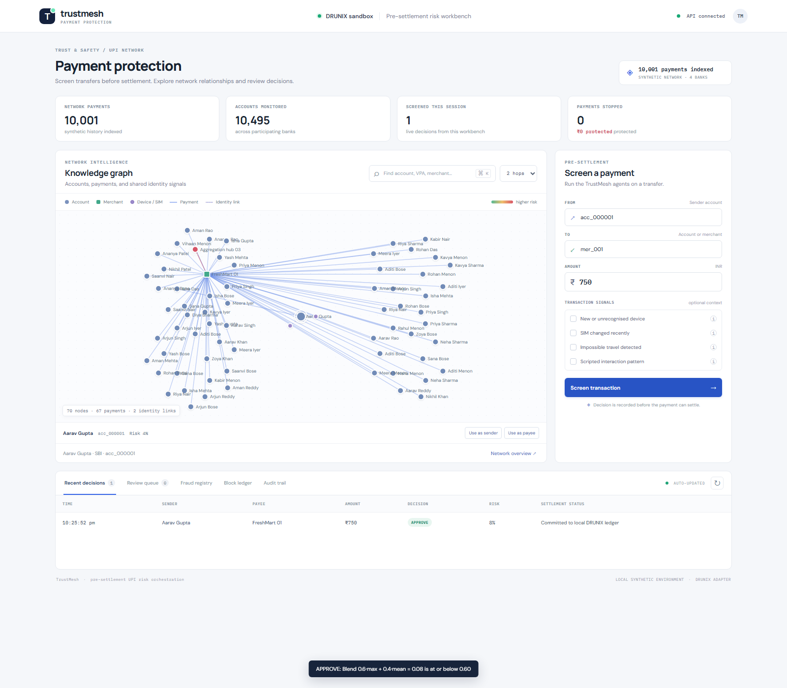
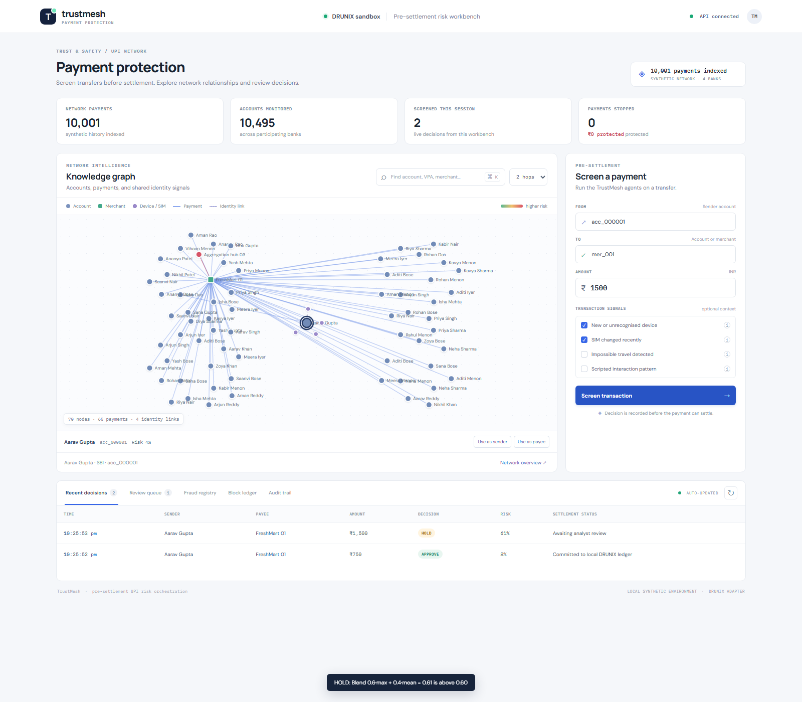
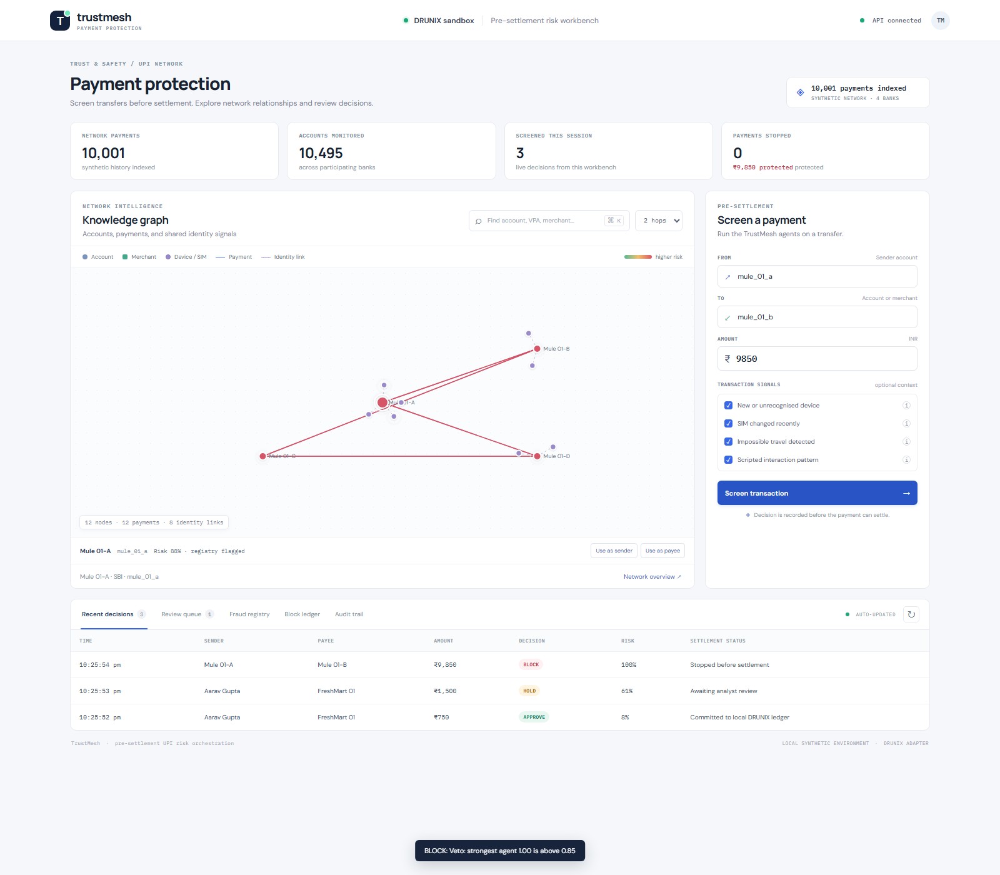

# TrustMesh example runs

These are **screenshots captured from the running TrustMesh website**, not generated mockups. They show the actual interactive knowledge graph, payment-screening form, selected signal checkboxes, latest decision row and in-app result message. The app was running locally on a fresh 10,000-payment synthetic network when the images were captured. No real accounts or transfers are involved.

## Before you run an example

1. Start TrustMesh with `npm start` and open `http://127.0.0.1:4173` (or use the port configured for your instance).
2. Confirm the header says **API connected**. The Knowledge graph and the **Screen a payment** form are both on the main page.
3. Fill **FROM**, **TO** and **AMOUNT**, set only the signals listed for that example, then click **Screen transaction**.
4. Read the newest row in **Recent decisions**. The graph refreshes around the sender. For HOLD, click **Review queue** to see the pending analyst action.

## Run 1 — familiar merchant payment: APPROVE

**Input:** FROM `acc_000001`; TO `mer_001`; amount `750`; leave all signal boxes unchecked.

**What is on screen:** The graph on the left is focused on the seeded account and shows nearby payments and entities; the form on the right is populated with the sample values. The newest row below reports `APPROVE`, an 8% risk score and local prototype commit status. The toast at the bottom shows the policy explanation.

**Why:** The synthetic account and merchant are familiar in the seeded history, and no extra device, SIM, travel or automation risk signals were supplied. This is the baseline to compare with the next two runs.

## Run 2 — new device and SIM: HOLD

**Input:** FROM `acc_000001`; TO `mer_001`; amount `1500`; check **New or unrecognised device** and **SIM changed recently**; leave the other two boxes unchecked.

**What is on screen:** The sender/recipient remain the same as Run 1, while the amount and two checkbox states change. The newest decision row shows `HOLD`, 61% risk and **Awaiting analyst review**. The tab counter for **Review queue** increments.

**Why:** The profile now has identity-change context. The risk is above the hold policy threshold but below the strongest-agent block threshold, so the app routes it to an analyst rather than treating it as safe or stopping it outright. Click **Review queue** to approve or reject it; a rejection adds the payee to the local fraud registry.

## Run 3 — mule-ring transfer: BLOCK

**Input:** FROM `mule_01_a`; TO `mule_01_b`; amount `9850`; check all four signals: **New or unrecognised device**, **SIM changed recently**, **Impossible travel detected**, and **Scripted interaction pattern**.

**What is on screen:** The live graph is focused on the mule account and shows the seeded three-account ring, red payment edges and device/SIM neighbors. The newest row shows `BLOCK`, 100% risk and **Stopped before settlement**. The blocked amount updates the payment-stopped metric and the toast identifies the policy veto.

**Why:** The high-risk synthetic mule network and the four explicit behavioral signals reinforce one another. The agent veto exceeds the block threshold, so this payment is stopped before the prototype's settlement step.

## Read the graph in these captures

- **Account nodes** are synthetic sender/recipient identities; merchant nodes use a square marker.
- **Solid directed lines** show payment direction. Dashed identity links connect accounts through shared device or SIM evidence.
- The view is an interactive local neighborhood around the focused account. The hop selector can expand the view; it does not draw all 10,000 or 300,000 synthetic transactions on one screen.
- Select any node to inspect its identity and evidence. Search for `acc_000001` or `mule_01_a` in **Find account, VPA, merchant…** to focus those same seeded examples.

The system pipeline is drawn in [ARCHITECTURE.md](../ARCHITECTURE.md#technical-architecture-and-request-pipeline). The abbreviated example table and the same screenshot snippets are also in the top-level [README](../README.md#example-runs).
