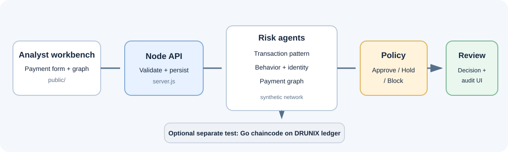
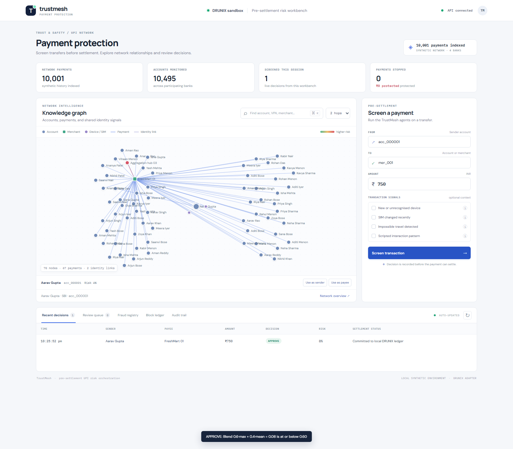
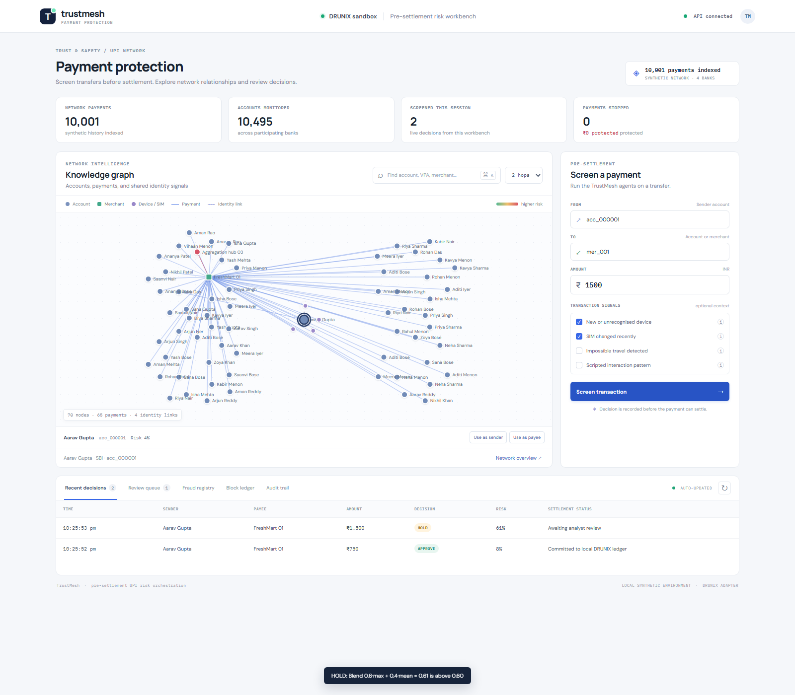
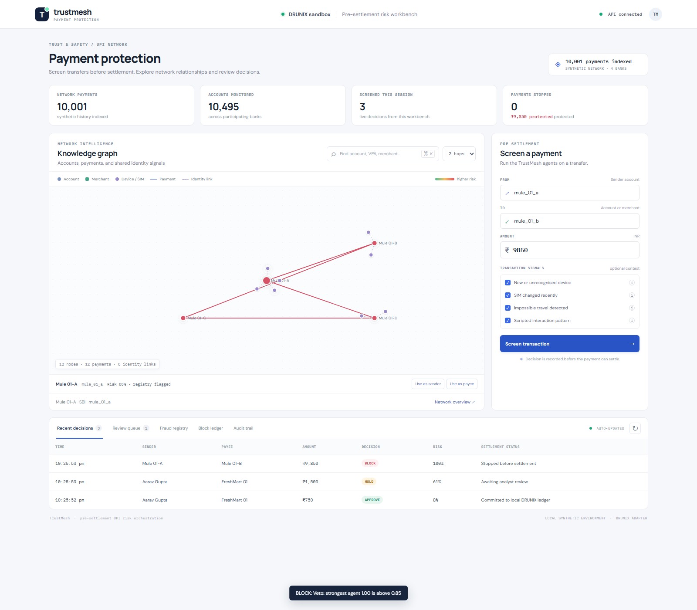

# TrustMesh: prototype guide

This guide shows where to click, what to enter, and how to read the knowledge graph and decisions. TrustMesh is a local prototype using synthetic data; it does not connect to live UPI accounts or move money. For full screenshots of the live page across all three runs, see [Example runs](EXAMPLE_RUNS.md).

## Start the app

From the repository root, run:

```powershell
npm start
```

Open `http://127.0.0.1:4173` (or the port printed by your server). The app builds its synthetic network at startup. The **API connected** indicator and the network counters at the top confirm that the browser can reach the backend.

## What the system does



1. The browser sends a screening request to the Node.js API.
2. The API runs three local agents: transaction-pattern (amount, velocity and time), behavioral (device, SIM, travel and automation signals), and graph-network (payment cycles, fan-in, pass-through and shared identities).
3. The orchestrator combines their scores. A maximum agent score above `0.85` blocks; otherwise blended risk above `0.60` is held for review; lower risk is approved.
4. The result appears in **Recent decisions** and the graph refreshes around the sender. A held payment can be approved or rejected by an analyst. Rejecting it adds its payee to the local fraud registry.
5. The Go chaincode and DRUNIX workflow are the optional test-ledger integration. The local workbench itself uses local synthetic data and local decision/audit storage; it does not write every browser decision to a running DRUNIX peer automatically.

### Knowledge graph, in plain terms

It is a map of entities and their relationships, rather than a bar or line chart. Account, merchant, device and SIM identities appear as nodes. Arrows show payments; identity links show accounts that share a device or SIM. Node color indicates relative risk. Selecting a node focuses the map and loads its details. The graph is served by `GET /api/graph`; the backend's graph agent uses the same relationship data to contribute risk evidence.

## How to open and explore the graph

1. Start the app and wait for the top counters and graph to finish loading. The **Knowledge graph** is already on the main page; there is no separate “build graph” action.
2. In **Find account, VPA, merchant…**, type `acc_000001` or `mule_01_a`. Choose the matching suggestion. The graph centers on that entity.
3. Use the **1 hop / 2 hops / 3 hops** selector to expand or narrow nearby relationships. Start with 2 hops for context.
4. Click a node to inspect its activity and evidence in the strip below the graph. Click **Network overview** to return to the default view.
5. To make a new relationship visible, screen a payment using the form. After a decision, the app refreshes the graph around the sender.

If the canvas is empty, check that the page says **API connected**, then refresh the page. Search a seeded ID such as `acc_000001`; the graph is not generated by clicking the decision tabs.

## Three example scenarios

The examples use deterministic seeded entities. In the payment form, enter the values exactly and leave signals off unless the row says to enable them. Click **Screen transaction**. Each diagram is illustrative: the actual visible neighborhood depends on graph depth and the selected entity.

### 1. Familiar merchant purchase — APPROVE



| Form field | Value |
|---|---|
| FROM | `acc_000001` |
| TO | `mer_001` |
| AMOUNT | `750` |
| Signals | Leave all four unchecked |

Expected: **APPROVE**. The payment appears under **Recent decisions**. Try searching for `acc_000001` in the graph to inspect the account, merchant and nearby history.

### 2. New device and SIM — HOLD for review



| Form field | Value |
|---|---|
| FROM | `acc_000001` |
| TO | `mer_001` |
| AMOUNT | `1500` |
| Signals | Check **New or unrecognised device** and **SIM changed recently** only |

Expected: **HOLD**. Click the **Review queue** tab. Select the held row and use its approve/reject action. Approval records the analyst decision; rejection adds the payee to the local fraud registry and the action is visible in the audit trail.

### 3. Mule-ring transfer — BLOCK



| Form field | Value |
|---|---|
| FROM | `mule_01_a` |
| TO | `mule_01_b` |
| AMOUNT | `9850` |
| Signals | Check all four: new device, SIM changed, impossible travel, scripted interaction |

Expected: **BLOCK**. Search `mule_01_a` in the graph and expand to 2 or 3 hops to inspect the seeded ring, payment paths and any shared identity links. The blocked result is listed under **Recent decisions** and **Block ledger**.

## Other places to click

- **Recent decisions**: latest screening outcomes and score explanations.
- **Review queue**: held transactions awaiting an analyst decision.
- **Fraud registry**: payees added after a rejected review.
- **Block ledger**: blocked local prototype decisions.
- **Audit trail**: append-only local record of screening and analyst actions.
- **Refresh** (↻): reload the visible decision and review data.

## API and implementation map

| Part | Responsibility |
|---|---|
| `public/index.html`, `public/app.js`, `public/app.css` | Analyst UI and interactive graph |
| `server.js` | Node HTTP API, request validation, agent orchestration and local persistence |
| `server/data-store.cjs` | Seeded synthetic network and graph/search indexes |
| `server/agents/transaction-pattern.cjs` | Amount, recent velocity and time-of-day signals |
| `server/agents/behavioral-biometric.cjs` | Device/SIM, travel, scripted input and shared-device signals |
| `server/agents/graph-network.cjs` | Cycles, fan-in, pass-through and relationship risk |
| `server/agents/orchestrator.cjs` | Final approve/hold/block policy |
| `chaincode/trustmesh/` | Go contracts for transaction gate, fraud registry and audit trail |
| `drunix-platform/` and `.github/workflows/` | DRUNIX sandbox source and optional GitHub Actions ledger smoke workflow |

The full component map and endpoint list are in [ARCHITECTURE.md](../ARCHITECTURE.md). Runnable JSON examples are also in [README.md](../README.md).
